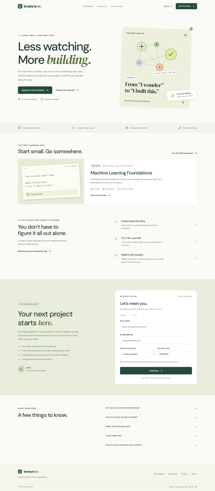
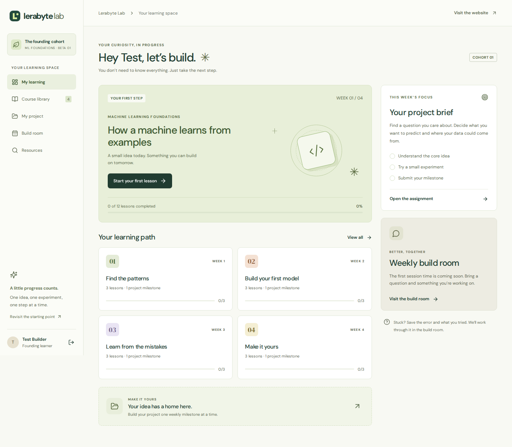

# Lerabyte Lab

A free, four-week machine learning platform for the first 15 beta participants. Built in `andronov5/hippos` with React, TypeScript, Vite, Express, and SQLite.

## What is built

- A responsive public website with a two-step beta application **on the homepage**, curriculum, resources, about page, sample lesson, and privacy notice.
- Email code sign-in with an HTTP-only session cookie. Applying does not grant learner access.
- A learner workspace with a dashboard, course library, 12 written lessons, 20 knowledge-check questions, saved progress, four project milestones, private feedback, and a weekly build room.
- An admin workspace for reviewing applications, approving up to 15 learners, editing lessons and video links, publishing/unpublishing lessons, reviewing projects, checking progress, and scheduling the group session.
- Server-side authorization for every private API request, immediate access revocation, input validation, origin checks, throttling, and persistent data.
- API integration tests, desktop/mobile browser tests, CI, and a Dockerfile.

This is an initial implementation, **not a live deployment**. The written curriculum is starter content for Lera to review. Recorded videos, a real email sender, actual cohort dates, and production hosting still need to be supplied. Missing videos are explicitly labeled in the learner UI; no fake video player or invented learner activity is shown.

## Preview

Homepage and learner workspace, captured from the running application with test data.





## Run locally

Use **Node 24.14 or newer within Node 24**. The server uses Node's built-in `node:sqlite` module.

```bash
npm ci
cp .env.example .env
npm run dev
```

Open `http://localhost:5173`. The API runs on `http://127.0.0.1:3001` and Vite proxies `/api` to it. Keep the documented ports unless you also update the proxy and `APP_ORIGIN`.

Set `ADMIN_EMAIL` in `.env` to your own email. For **local development only**, `DEV_AUTH_CONSOLE=true` prints the one-time sign-in code in the server terminal. Copy that code into the sign-in page. There is no built-in password, public admin token, or client-side bypass. Development servers bind only to loopback.

1. Apply on the homepage using a second email.
2. Sign in as the configured admin and open **Manage the lab**.
3. Review the application and change its status to **Approved**.
4. Sign in as the applicant to use the private learning space.
5. Complete a lesson check, submit a project milestone, and review it from the admin account.

Approval changes access immediately. Approval does **not** send an invitation email; notify accepted learners yourself and direct them to `/signin`. Applicants can sign in to check their status before acceptance.

## Routes

| Route               | Purpose                                         | Access                    |
| ------------------- | ----------------------------------------------- | ------------------------- |
| `/` and `/#apply`   | Homepage and beta application                   | Public                    |
| `/program`          | Four-week curriculum                            | Public                    |
| `/resources`        | Searchable official readings                    | Public                    |
| `/about`            | Program introduction                            | Public                    |
| `/sample`           | Interactive sample lesson                       | Public                    |
| `/privacy`          | Data and privacy notice                         | Public                    |
| `/signin`           | Email verification                              | Public                    |
| `/application`      | Your application status                         | Signed in                 |
| `/learn`            | Learning dashboard                              | Approved learner or admin |
| `/learn/course`     | Units and lesson list                           | Approved learner or admin |
| `/learn/lesson/:id` | Lesson, reading, practice, knowledge check      | Approved learner or admin |
| `/learn/projects`   | Project submissions and feedback                | Approved learner or admin |
| `/learn/sessions`   | Group session details                           | Approved learner or admin |
| `/learn/resources`  | Readings inside the workspace                   | Approved learner or admin |
| `/admin`            | Applications, content, reviews, cohort, session | Verified admin only       |

## Production configuration

Deploy this as **one Node server with persistent disk**, behind HTTPS. The frontend and API must share the same origin. GitHub Pages or a static-only host cannot run the database and authentication server.

```bash
npm ci
npm run build
NODE_ENV=production npm start
```

Required environment settings:

| Variable                              | Purpose                                                                       |
| ------------------------------------- | ----------------------------------------------------------------------------- |
| `APP_ORIGIN`                          | Exact public HTTPS origin, without a path; e.g. `https://lab.example.com`     |
| `ADMIN_EMAIL`                         | The trusted admin email; verified by a one-time code before access is granted |
| `DATABASE_PATH`                       | SQLite path on a persistent disk, e.g. `/app/data/lerabyte.sqlite`            |
| `SMTP_HOST`, `SMTP_PORT`, `SMTP_FROM` | Your authenticated email delivery service                                     |
| `SMTP_USER`, `SMTP_PASS`              | SMTP credentials when required by the provider                                |
| `SMTP_SECURE`                         | `true` for implicit TLS, normally port 465; otherwise STARTTLS is required    |
| `DEV_AUTH_CONSOLE`                    | Must be `false` or unset in production                                        |
| `TRUST_PROXY_HOPS`                    | Exact number of trusted reverse-proxy hops; default `0`                       |
| `APPLICATIONS_OPEN`                   | `true` to accept applications; `false` to close the form                      |
| `PORT`                                | Server listen port; default `3001`                                            |

Startup refuses production mode without an HTTPS origin, an admin email, and an email sender, or if development code logging is enabled. Configure a sender/domain you control. No SMTP account is created or billed by this repository.

For Docker, build with `docker build -t lerabyte-lab .`, provide the environment variables above, and mount a persistent volume at `/app/data`. The image runs as the unprivileged `node` user. A reverse proxy should terminate TLS. Never put the SQLite database on an ephemeral deployment filesystem. Keep encrypted, access-controlled backups using SQLite's backup tooling; copying only the live `.sqlite` file can omit data in its WAL file. The beta is deliberately a single-instance setup; migrate storage and shared throttling before horizontal scaling.

## Content and operating the beta

- Public titles, unit descriptions, milestones, and reading links: `shared/course.mjs`.
- Initial private lesson text, exercises, takeaways, and quiz answer keys: `server/lessons.mjs`.
- On first startup, written lesson bodies are seeded into SQLite. Admin edits persist in the database and are not overwritten by subsequent server starts. Changing seed text later does not overwrite an existing lesson.
- Answer keys and private lesson bodies are not included in the public frontend bundle. Quiz scoring is performed on the server. Learners need 80% on a lesson check to mark it complete; attempts can be retried. Lesson completion and project review are separate.
- Videos accept privacy-enhanced YouTube embed URLs or Vimeo player URLs. Configure privacy/domain restrictions with your video host. Access to a page does not make an external video URL confidential. Add captions to recordings. The written lesson remains available alongside each recording.
- A learner may submit one milestone per week and revise it. Resubmitting returns the review status to `submitted` while keeping earlier feedback visible. Reviews are private to the learner and admin.
- Session times are stored in UTC and displayed in the viewer's local time zone. No launch dates or meetings are fabricated.
- Only approve learners whose participation and contact arrangements you have reviewed. Before opening the live beta, confirm the curriculum, schedule, retention policy, and any participation arrangements relevant to your actual audience.
- Public project sharing, automated invitation/reminder emails, file uploads, live chat, billing, multiple courses/cohorts, downloadable starter notebooks, and video hosting are not implemented in this first version. Project submissions use HTTPS links.

## Data and security

SQLite tables store applications, verified users, hashed one-time codes, hashed session tokens, lesson text, progress, submissions, and session settings. Application emails are trimmed and lowercased. Repeat anonymous applications receive a generic confirmation and do not overwrite prior submissions.

Codes expire after ten minutes and allow at most five incorrect attempts. Sessions expire after seven days; logout revokes the server session. Cookies use HttpOnly and SameSite=Lax, plus Secure in production. Admin access comes from the server's configured email, never a browser-supplied role. Each private request checks current approval, and each learner query is scoped to that authenticated user's ID. All SQL values use bound parameters.

The rate limiter is in memory for the one-server beta. It resets on process restart. It complements persistent per-email code attempt limits and resend cooldowns. Configure reverse-proxy hops accurately so clients cannot spoof the IP used for throttling.

Treat the database and backups as private. The repository ignores `.env`, databases, runtime data, and browser reports. Never commit credentials or real application data. The first version has no public learner directory and includes no advertising analytics.

## Checks

```bash
npm run format:check
npm run check
npx playwright install chromium
npm run test:e2e
```

`npm run check` runs the TypeScript/production build and nine API integration tests. They cover application validation, email verification, access gates, learner isolation, server-side grading, cohort capacity, revocation, admin content/reviews, CSRF protection, logout, database persistence, and production startup constraints.

Browser tests use a temporary database and an injected test mail sender; no real email is sent and no production data is touched. They exercise the mobile application flow, pending status, admin approval, learner login, saved progress, project feedback, content edits, navigation, reading filters, and the sample quiz. Screenshots and traces are written to ignored `test-results/`.

## Structure

```text
src/                 React routes, shared components, styles, and API client
shared/course.mjs    Public curriculum metadata
server/app.mjs       HTTP API, email authentication, authorization, and validation
server/db.mjs        SQLite schema and initial lesson seeding
server/lessons.mjs   Private written content and knowledge-check answer keys
tests/               API integration and browser tests
```

Reference documentation: [Node SQLite](https://nodejs.org/docs/latest-v24.x/api/sqlite.html), [Vite](https://vite.dev/guide/), [Express security practices](https://expressjs.com/en/advanced/best-practice-security/), and the official reading links in the curriculum.
